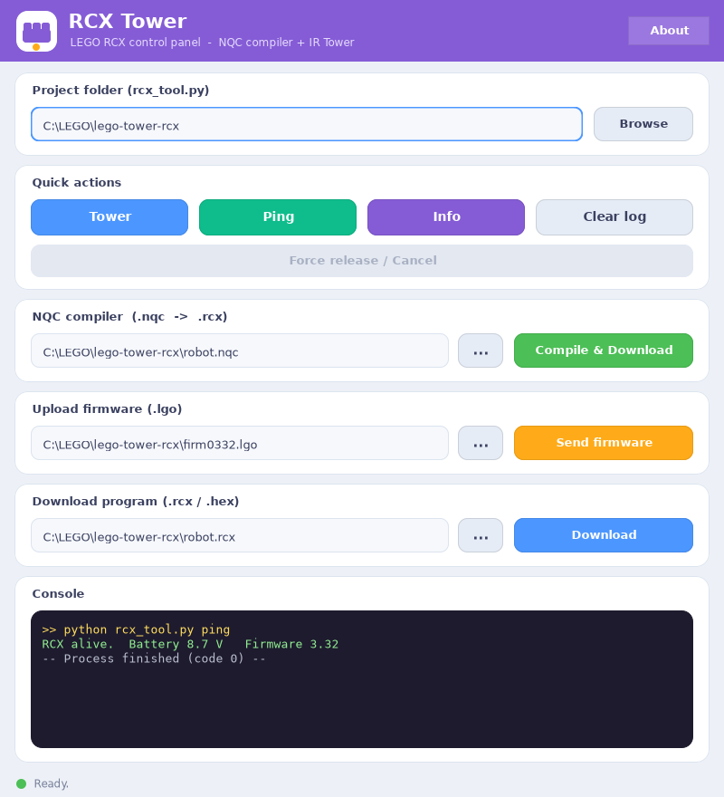
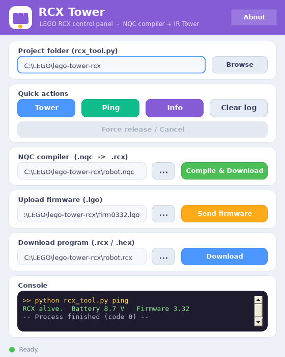

# RCX Tower GUI

**Un IDE sencillo para [beckmx/lego-tower-rcx](https://github.com/beckmx/lego-tower-rcx).**

Una app de Windows de un solo archivo que le pone interfaz gráfica a `rcx_tool.py` y a
`nqc.exe`, para compilar y mandar programas al RCX 2.0 sin escribir comandos.

*English: [README.md](README.md)*



---

## Qué hace

[beckmx/lego-tower-rcx](https://github.com/beckmx/lego-tower-rcx) es el toolkit que vuelve
a hacer funcionar la torre LEGO USB IR en Windows 10/11. Funciona muy bien, pero todo se
maneja por línea de comandos. Esto es la interfaz:

| Botón | Ejecuta |
|---|---|
| **Tower** | `python rcx_tool.py tower` |
| **Ping** | `python rcx_tool.py ping` |
| **Info** | `python rcx_tool.py info` |
| **Compile & Download** | `nqc -Trcx2 "programa.nqc"` y descarga el `.rcx` generado |
| **Send firmware** | `python rcx_tool.py firmware "firm0332.lgo"` |
| **Download** | `python rcx_tool.py download "programa.rcx"` |
| **Force release / Cancel** | mata el proceso (y sus hijos) y libera la torre |

Todo lo que imprime `rcx_tool.py` —salida y errores— aparece en vivo en la consola, con
colores. Los errores del compilador `nqc` también salen ahí, con su número de línea.

El botón **Compile & Download** es la razón de ser de todo esto: editás tu `.nqc`, apretás
un botón, y el programa queda compilado y cargado en el ladrillo.

## Características

- **Autodetección.** Busca `rcx_tool.py`, `nqc.exe`, `python.exe` y `firm0332.lgo` en su
  propia carpeta, así que al abrir ya están todas las rutas puestas.
- **Consola en vivo.** Comando en amarillo, salida en verde, errores en rojo, info en celeste.
- **Watchdog.** Si un comando se cuelga, el panel se libera solo a los 8 segundos en vez de
  quedarse trabado. El firmware tiene 180 segundos, porque cargarlo al ladrillo tarda
  legítimamente más que ese límite.
- **Redimensionable.** Jalás de cualquier borde; abajo de 800 px de alto cambia a un modo
  compacto y la consola se queda con el alto que sobre. Recuerda el tamaño entre sesiones.
- **Sin instalación.** Un solo `.exe`, sin runtime que bajar, sin tocar el registro.

<p align="center">
  
  <br><em>Modo compacto, en el mínimo de 560 × 700</em>
</p>

## Requisitos

Todo lo que pide [lego-tower-rcx](https://github.com/beckmx/lego-tower-rcx), más:

- Windows 10 u 11
- .NET Framework 4.x — ya viene con Windows 10/11, no hay que instalar nada

Del proyecto original:

- Python 3.10 o superior con `pyusb` (`pip install pyusb`)
- El driver libusbK, instalado con Zadig
- Torre LEGO USB IR (VID `0694`, PID `0001`) y un ladrillo RCX 2.0

## Instalación

1. Configurá primero [lego-tower-rcx](https://github.com/beckmx/lego-tower-rcx) y verificá
   que `python rcx_tool.py ping` responda.
2. Bajá `RCXTowerGUI.exe` de [Releases](../../releases) (o de la carpeta `dist/`).
3. **Copialo a la misma carpeta** donde están `rcx_tool.py`, `nqc.exe` y `firm0332.lgo`.
4. Doble clic.

Esa estructura de carpeta es lo que hace que funcione la autodetección:

```
lego-tower-rcx/
├── rcx_tool.py
├── nqc.exe
├── firm0332.lgo
├── libusb-1.0.dll
└── RCXTowerGUI.exe   <- ponelo acá
```

## Compilar desde el código

Sin IDE, sin SDK, sin descargas: Windows ya trae el compilador de C#.

```bat
build.bat
```

O a mano:

```bat
%WINDIR%\Microsoft.NET\Framework64\v4.0.30319\csc.exe /target:winexe /platform:anycpu ^
    /out:RCXTowerGUI.exe /r:System.dll /r:System.Windows.Forms.dll /r:System.Drawing.dll ^
    /resource:assets\rcx.ico,rcx.ico /win32icon:assets\rcx.ico src\RCXTowerGUI.cs
```

CI hace lo mismo en cada push (`.github/workflows/build.yml`) y deja el binario como
artefacto, así cada commit queda probado con el compilador propio de Microsoft.

## Problemas comunes

**SmartScreen dice "Windows protegió su PC".** El binario no está firmado digitalmente.
*Más información → Ejecutar de todas formas*, o compilalo vos con `build.bat`.

**No abre del todo.** Ejecutá `diagnose.bat`: revisa que estén los archivos necesarios,
reporta la versión de .NET Framework instalada, arranca la app con consola visible y
muestra el error si lo hubo. Los errores fatales también quedan en
`%TEMP%\RCXTowerGUI-error.txt`.

**"rcx_tool.py not found".** La app no está en la misma carpeta que el toolkit: movela ahí,
o apuntá el campo *Project folder* a la carpeta correcta.

**Botones grises.** Hay un comando corriendo. Apretá *Force release / Cancel*, que siempre
devuelve el panel a un estado usable.

**Volver al tamaño de ventana original.** Borrá `%APPDATA%\RCXTowerGUI\window.txt`.

## Créditos

- [beckmx](https://github.com/beckmx) — [lego-tower-rcx](https://github.com/beckmx/lego-tower-rcx),
  el toolkit que hace el trabajo real de hablar con la torre y el ladrillo. Esta GUI es
  solamente una interfaz encima de eso.
- `nqc` — Not Quite C, el compilador del RCX de Dave Baum.
- GUI por Jim Bolaños, 2026. Estilo visual inspirado en Scratch 3.

## Licencia

Mozilla Public License 1.0, la misma del proyecto original
[lego-tower-rcx](https://github.com/beckmx/lego-tower-rcx). Ver [LICENSE](LICENSE).
