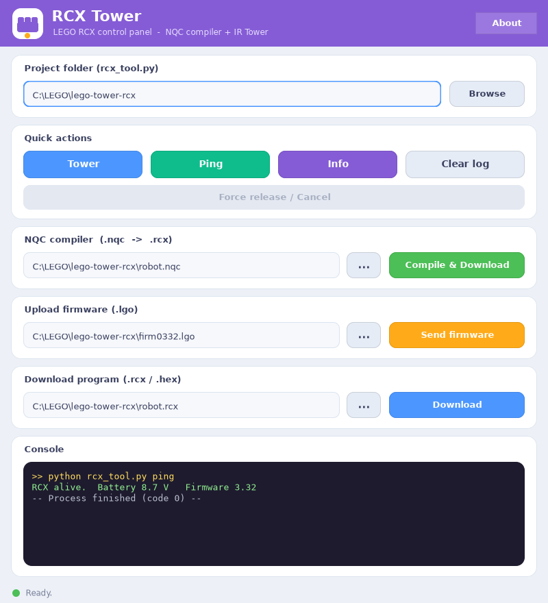
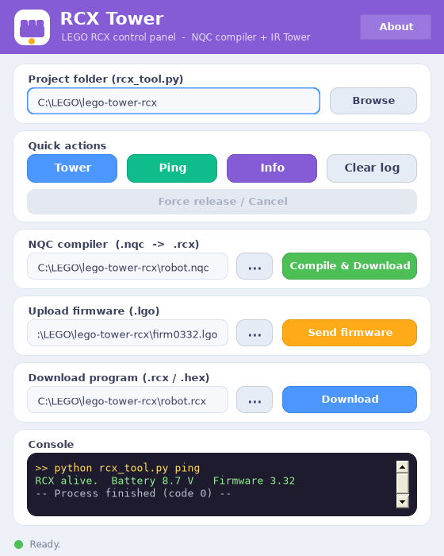

# RCX Tower GUI

**A simple IDE for [beckmx/lego-tower-rcx](https://github.com/beckmx/lego-tower-rcx).**

A single-file Windows app that puts a point-and-click interface on top of `rcx_tool.py`
and `nqc.exe`, so you can compile and send programs to a LEGO RCX 2.0 brick without
typing commands.

*Español: [README.es.md](README.es.md)*



---

## What it does

[beckmx/lego-tower-rcx](https://github.com/beckmx/lego-tower-rcx) is the toolkit that
makes the LEGO USB IR Tower work again on Windows 10/11. It works great, but everything
runs from the command line. This is the front-end:

| Button | Runs |
|---|---|
| **Tower** | `python rcx_tool.py tower` |
| **Ping** | `python rcx_tool.py ping` |
| **Info** | `python rcx_tool.py info` |
| **Compile & Download** | `nqc -Trcx2 "program.nqc"`, then downloads the generated `.rcx` |
| **Send firmware** | `python rcx_tool.py firmware "firm0332.lgo"` |
| **Download** | `python rcx_tool.py download "program.rcx"` |
| **Force release / Cancel** | kills the running process (and its children) and frees the tower |

Everything `rcx_tool.py` prints — stdout and stderr — streams live into the console pane,
colour-coded. Compiler errors from `nqc` show up there too, with their line numbers.

The one-click **Compile & Download** is the point of the whole thing: edit your `.nqc`,
press one button, and the program is compiled and flashed to the brick.

## Features

- **Auto-detection.** Finds `rcx_tool.py`, `nqc.exe`, `python.exe` and `firm0332.lgo`
  in its own folder, so every path is pre-filled on launch.
- **Live console.** Command in yellow, output in green, errors in red, info in cyan.
- **Watchdog.** If a command hangs, the panel releases itself after 8 seconds instead of
  freezing. Firmware uploads get 180 seconds, since flashing the brick legitimately
  takes longer than that limit.
- **Resizable.** Drag any edge; below 800 px tall it switches to a compact layout, and
  the console absorbs whatever height is left. The window size is remembered between runs.
- **No install.** One `.exe`, no runtime to download, nothing written to the registry.

<p align="center">
  
  <br><em>Compact layout at the 560 × 700 minimum</em>
</p>

## Requirements

Everything [lego-tower-rcx](https://github.com/beckmx/lego-tower-rcx) needs, plus:

- Windows 10 or 11
- .NET Framework 4.x — already included in Windows 10/11, nothing to install

From the upstream project:

- Python 3.10+ with `pyusb` (`pip install pyusb`)
- The libusbK driver, installed with Zadig
- LEGO USB IR Tower (VID `0694`, PID `0001`) and an RCX 2.0 brick

## Install

1. Set up [lego-tower-rcx](https://github.com/beckmx/lego-tower-rcx) first and confirm
   `python rcx_tool.py ping` answers.
2. Download `RCXTowerGUI.exe` from [Releases](../../releases) (or from `dist/`).
3. **Copy it into the same folder** as `rcx_tool.py`, `nqc.exe` and `firm0332.lgo`.
4. Double-click.

That folder layout is what makes the auto-detection work:

```
lego-tower-rcx/
├── rcx_tool.py
├── nqc.exe
├── firm0332.lgo
├── libusb-1.0.dll
└── RCXTowerGUI.exe   <- drop it here
```

## Build from source

No IDE, no SDK, no downloads — Windows already ships the C# compiler:

```bat
build.bat
```

Or by hand:

```bat
%WINDIR%\Microsoft.NET\Framework64\v4.0.30319\csc.exe /target:winexe /platform:anycpu ^
    /out:RCXTowerGUI.exe /r:System.dll /r:System.Windows.Forms.dll /r:System.Drawing.dll ^
    /resource:assets\rcx.ico,rcx.ico /win32icon:assets\rcx.ico src\RCXTowerGUI.cs
```

CI does the same on every push (`.github/workflows/build.yml`) and attaches the binary
as an artifact, so each commit is proven to compile with Microsoft's own compiler.

## Troubleshooting

**SmartScreen says "Windows protected your PC".** The binary is not code-signed.
*More info → Run anyway*, or build it yourself with `build.bat`.

**It doesn't open at all.** Run `diagnose.bat`: it checks that the required files are in
the folder, reports the installed .NET Framework version, launches the app with a visible
console, and prints any recorded error. Fatal errors are also written to
`%TEMP%\RCXTowerGUI-error.txt`.

**"rcx_tool.py not found".** The app is not in the same folder as the toolkit — either
move it there, or point the *Project folder* field at the right directory.

**Buttons greyed out.** A command is still running. Press *Force release / Cancel*, which
always returns the panel to a usable state.

**Reset the window size.** Delete `%APPDATA%\RCXTowerGUI\window.txt`.

## Credits

- [beckmx](https://github.com/beckmx) — [lego-tower-rcx](https://github.com/beckmx/lego-tower-rcx),
  the toolkit that does the actual work of talking to the tower and the brick. This GUI is
  only a front-end for it.
- `nqc` — Not Quite C, the RCX compiler by Dave Baum.
- GUI by Jim Bolaños, 2026. Visual style inspired by Scratch 3.

## License

Mozilla Public License 1.0, matching the upstream
[lego-tower-rcx](https://github.com/beckmx/lego-tower-rcx) project. See [LICENSE](LICENSE).
