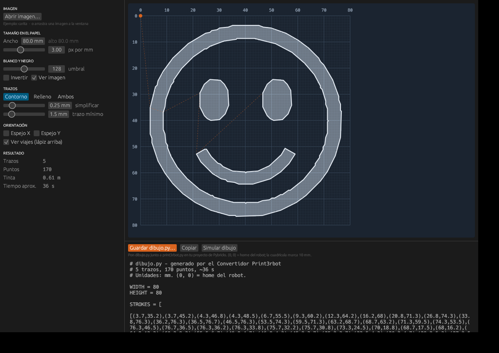

# Convertidor Print3rbot (Rust)

App de escritorio para Windows, macOS y Linux que convierte una imagen sencilla en
`dibujo.py` para `../print3rbot.py`. Hace lo mismo que `../convertidor.html`, pero como
programa nativo: abre imágenes desde el disco, se pueden arrastrar a la ventana y guarda
`dibujo.py` directamente.



## Descargar

Cada push que toca esta carpeta compila la app en GitHub Actions (workflow
*Convertidor Print3rbot*). En la pestaña **Actions** del repo, abre la última ejecución y
descarga el artefacto de tu sistema:

| Artefacto | Sistema |
|---|---|
| `print3rbot-convertidor-windows-x64` | Windows 10/11 |
| `print3rbot-convertidor-macos-arm64` | Mac con Apple Silicon (M1 o más nuevo) |
| `print3rbot-convertidor-macos-x64` | Mac con Intel |
| `print3rbot-convertidor-linux-x64` | Linux |

En macOS, la primera vez: clic derecho sobre el archivo → **Abrir** (no está firmado).
Si se descargó sin permiso de ejecución: `chmod +x print3rbot-convertidor`.

## Compilar desde el código

Necesitas Rust (https://rustup.rs). Luego:

```sh
cd ev3-print3rbot/convertidor-rs
cargo run --release
```

El ejecutable queda en `target/release/`. Pruebas del algoritmo: `cargo test --lib`.

En Linux hacen falta las bibliotecas de escritorio habituales (`libxkbcommon-x11`, OpenGL);
casi todas las distribuciones con escritorio ya las traen.

## Código

- `src/trace.rs`: imagen → blanco y negro → contornos (marching squares) y rayado,
  simplificación (Ramer-Douglas-Peucker), orden por vecino más cercano y salida en Python.
  No depende de la interfaz y tiene pruebas.
- `src/main.rs`: interfaz con egui/eframe.
